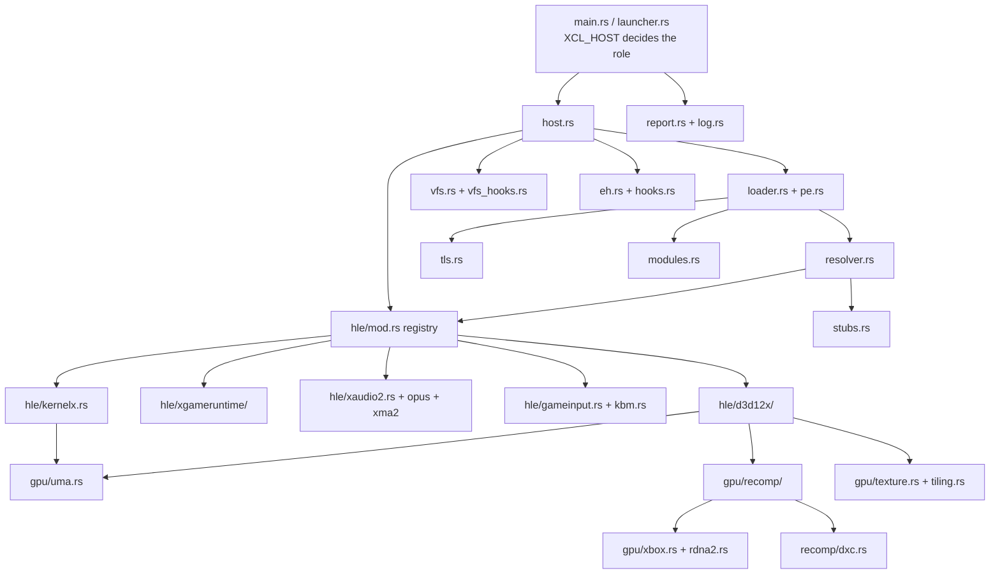
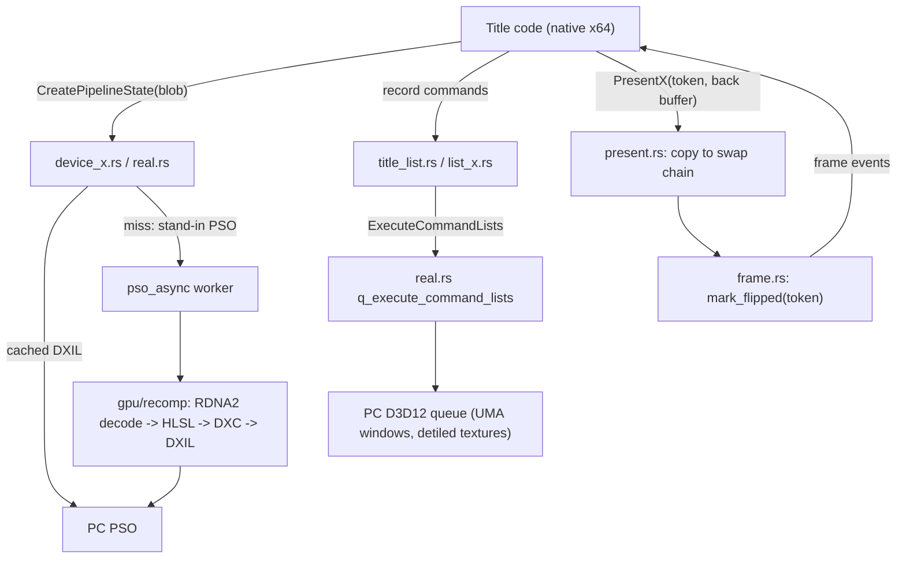

# Architecture

The end-to-end picture of XCL, from `xcl run` to a frame on screen. Each section is a summary of a
component page; follow the links for the per-file detail. Paths are repo-relative and `file:line`
points at the item described. Read from the source, not run on the machine that wrote this page: the
crate builds and runs on Windows only (`AGENTS.md:27`).

## Process model

`xcl run` is two processes started from the same `xcl.exe`; the environment variable `XCL_HOST` tells
them apart (`crates/xcl/src/main.rs:48`).

- **Launcher** (`crates/xcl/src/launcher.rs:288`): resolves the package, loads or creates `xcl.toml`,
  fills "auto" settings from `MicrosoftGame.config`, writes `cache\boot.json`, runs the PC checks, then
  starts the host with `XCL_HOST=<boot.json>` and waits (`crates/xcl/src/launcher.rs:433`-`crates/xcl/src/launcher.rs:470`).
  It merges the exit code into `report.json` (`crates/xcl/src/launcher.rs:472`).
- **Host** (`crates/xcl/src/host.rs:11`): initialises the stub database and HLE registry
  (`crates/xcl/src/host.rs:106`-`crates/xcl/src/host.rs:107`), builds the VFS and installs file hooks
  (`crates/xcl/src/host.rs:119`-`crates/xcl/src/host.rs:122`), installs exception hooks
  (`crates/xcl/src/host.rs:125`-`crates/xcl/src/host.rs:129`), then loads the title's exe
  (`crates/xcl/src/loader.rs:312`) and runs its entry point on a new thread
  (`crates/xcl/src/loader.rs:352`-`crates/xcl/src/loader.rs:367`). The title runs inside the host process.

Details: [runtime-core.md](runtime-core.md), "How a title starts".

## Loading

- **PE loader** (`crates/xcl/src/loader.rs:64`, `map_image_ex`): maps the image, applies relocations,
  resolves all imports eagerly, sets up static TLS, registers `.pdata`
  (`crates/xcl/src/loader.rs:163`-`crates/xcl/src/loader.rs:230`). The parser is `crates/xcl/src/pe.rs:229`.
- **Imports** (`crates/xcl/src/resolver.rs:315`, `resolve_import`): routing table (HLE module, `@system`,
  `@stub`), then a DLL shipped in the game folder, then a real Windows DLL, then any HLE module that has
  the name, then a logging stub (`crates/xcl/src/resolver.rs:211`-`crates/xcl/src/resolver.rs:262`). The
  route table is `Registry::route` (`crates/xcl/src/hle/mod.rs:207`).
- **Stubs** (`crates/xcl/src/stubs.rs:111`): a generated x64 thunk that logs the first call and returns a
  configured value; defaults in `crates/xcl/data/stubdb.toml:8`.
- **TLS** (`crates/xcl/src/tls.rs:451`): a generated carrier DLL gives manually mapped images a real
  Windows TLS slot; the exe takes slot 0 (`crates/xcl/src/tls.rs:310`).
- **Exceptions** (`crates/xcl/src/eh.rs:20`, `crates/xcl/src/eh.rs:45`): `.pdata` is registered with
  `RtlAddFunctionTable` and `RtlPcToFileHeader` is hooked so C++ `throw` works in mapped images; the crash
  handler is `crates/xcl/src/eh.rs:144`; console-only CPU instructions are emulated on `0xC000001D`
  (`crates/xcl/src/eh.rs:315`).

Details: [runtime-core.md](runtime-core.md).

## Runtime services (HLE)

A console DLL is replaced by an HLE module, "a name -> function address table"
(`crates/xcl/src/hle/mod.rs:1`); the functions are Rust `extern "system"` functions the title's native
code calls directly. The registry is built once by `hle::init` (`crates/xcl/src/hle/mod.rs:198`, called
from `crates/xcl/src/host.rs:107`). Details: [hle.md](hle.md).

- **kernelx memory and threads** (`crates/xcl/src/hle/kernelx.rs:1`): `VirtualAlloc` with console flags
  stripped (`crates/xcl/src/hle/kernelx.rs:235`) that places 64 KiB-page reservations in a UMA sparse
  window so the GPU sees them, physical-page APIs (`crates/xcl/src/hle/kernelx.rs:1050`), thread affinity
  fitted to the PC (`crates/xcl/src/hle/kernelx.rs:1331`). Everything else falls back to the real
  KERNELBASE / KERNEL32 export (`crates/xcl/src/hle/mod.rs:100`).
- **VFS overlay** (`crates/xcl/src/vfs.rs:1`-`crates/xcl/src/vfs.rs:8`): console paths (`G:\`, `GAME:`,
  `D:`, `T:\`, `S:\`) map to PC locations; the game folder is read-only, a write copies that one file to
  `<data>\overlay\`, a delete records a whiteout. `crates/xcl/src/vfs_hooks.rs:1182` installs the inline
  hooks on KERNELBASE file functions. Direct `Nt*` file calls bypass it (`crates/xcl/src/vfs_hooks.rs:9`).
- **XGameRuntime** (`crates/xcl/src/hle/xgameruntime/api.rs:1`): titles call `InitializeApiImpl` and get
  COM-style objects from `QueryApiImpl` (`crates/xcl/src/hle/xgameruntime/api.rs:265`). Refused classes
  (`crates/xcl/src/hle/xgameruntime/api.rs:100`), then XCL's own offline objects
  (`crates/xcl/src/hle/xgameruntime/api.rs:680`), then the PC `xgameruntime.dll`
  (`crates/xcl/src/hle/xgameruntime/api.rs:137`).
- **Reporting**: `report.json` is written by `crates/xcl/src/report.rs` and finished by the launcher
  (see [cli-and-config.md](cli-and-config.md), "Files a run writes").

## Graphics

Details: [d3d12x.md](d3d12x.md) and [gpu-recompiler.md](gpu-recompiler.md).

- **Device and command lists.** `backend()` picks the real D3D12 backend or a null one
  (`crates/xcl/src/hle/d3d12x/mod.rs:70`). The real backend hands the title genuine driver objects with
  vtables replaced by extended copies (`adopt`, `crates/xcl/src/hle/d3d12x/real.rs:702`): PC methods
  stay, console-only slots become guard thunks (`crates/xcl/src/hle/d3d12x/guard.rs`) or logging stubs.
  Console device methods are in `crates/xcl/src/hle/d3d12x/device_x.rs`, command-list methods in
  `crates/xcl/src/hle/d3d12x/list_x.rs`. `create_list` wraps the PC list so inline command writes become
  method calls (`crates/xcl/src/hle/d3d12x/device_x.rs:95`, `crates/xcl/src/hle/d3d12x/title_list.rs:3`).
- **Console shaders to PSO.** The blob is a DXBC container whose DXIL part holds RDNA2 machine code
  (`crates/xcl/src/gpu/xbox.rs:1`). The path is `xbox::parse` (`crates/xcl/src/gpu/xbox.rs:185`),
  `rdna2::decode` (`crates/xcl/src/gpu/rdna2.rs`), `recomp::translate` to HLSL
  (`crates/xcl/src/gpu/recomp/mod.rs:1296`), `dxc::compile_cached` to DXIL
  (`crates/xcl/src/gpu/recomp/dxc.rs:887`), then a PC PSO (`crates/xcl/src/gpu/recomp/pso.rs:108`). A
  pipeline whose DXIL is not cached gets a stand-in PSO immediately and a worker builds the real one
  (`standin_graphics`, `crates/xcl/src/hle/d3d12x/real.rs:3648`; `attempt`,
  `crates/xcl/src/hle/d3d12x/real.rs:3176`).
- **UMA memory.** Title graphics memory is kept in up to four windows of at most 4095 MiB at
  `base + k * 4 GiB`; the window of an address is `(address >> 32) & 3` (`crates/xcl/src/gpu/uma.rs:1`).
  The recompiled HLSL picks the window from the high address bits (`crates/xcl/src/gpu/recomp/mod.rs:471`).
  Placed resources are routed to `vram`, `title_textures` or `sparse`
  (`crates/xcl/src/hle/d3d12x/device_x.rs:858`).
- **Textures.** Console textures are written tiled by the title; `crates/xcl/src/gpu/desc.rs` decodes
  descriptors, `crates/xcl/src/gpu/tiling.rs` and `crates/xcl/src/gpu/texture.rs` detile them.
- **Present and frame clock.** Titles call `PresentX` with a frame token, not a swap chain
  (`crates/xcl/src/hle/d3d12x/present.rs:5`-`crates/xcl/src/hle/d3d12x/present.rs:7`); XCL copies the
  back buffer into its own window's swap chain (`crates/xcl/src/hle/d3d12x/present.rs:593`) and tells the
  frame clock the token flipped (`mark_flipped`, `crates/xcl/src/hle/d3d12x/frame.rs:380`). The clock thread
  (`crates/xcl/src/hle/d3d12x/frame.rs:439`) serves `SetFrameIntervalX` and the frame events. It is not
  locked to the monitor's vblank (`crates/xcl/src/hle/d3d12x/frame.rs:14`).

## Audio

`xaudio2` exports `XAudio2Create` (`crates/xcl/src/hle/xaudio2.rs:165`), creates the genuine Windows
engine (`crates/xcl/src/hle/xaudio2.rs:726`) and patches its vtables in place
(`crates/xcl/src/hle/xaudio2.rs:681`). Opus and XMA2 source voices are decoded by `hle::opus` and
`hle::xma2` into PCM voices (`crates/xcl/src/hle/xaudio2.rs:833`, `crates/xcl/src/hle/xaudio2.rs:867`).

## Input

`GameInput.dll` is replaced by `GameInputCreate` (`crates/xcl/src/hle/gameinput.rs:987`): one gamepad that
is always connected, read from the first XInput controller plus keyboard and mouse
(`poll`, `crates/xcl/src/hle/gameinput.rs:303`). `hle/kbm.rs` registers Raw Input on XCL's window
(`crates/xcl/src/hle/kbm.rs:254`) and maps keys to sticks and buttons (`crates/xcl/src/hle/kbm.rs:392`);
the `keyboard_mouse` setting is on by default (`crates/xcl/src/config.rs:71`).

## Module graph

## Data flow of one frame

`q_execute_command_lists` is at `crates/xcl/src/hle/d3d12x/real.rs:4756`; the order of its steps is
described in [d3d12x.md](d3d12x.md), "Data flow".

## Where to start reading the code for X

| To understand ... | Start at | Page |
|---|---|---|
| How `xcl run` starts a title | `crates/xcl/src/launcher.rs:288`, `crates/xcl/src/host.rs:11` | [runtime-core.md](runtime-core.md) |
| Why an import resolves to what it does | `crates/xcl/src/resolver.rs:315` | [runtime-core.md](runtime-core.md) |
| Adding or finding an HLE function | `crates/xcl/src/hle/mod.rs:198` | [hle.md](hle.md) |
| A crash in the title | `crates/xcl/src/eh.rs:144` | [runtime-core.md](runtime-core.md) |
| File access and save data | `crates/xcl/src/vfs.rs:159`, `crates/xcl/src/vfs_hooks.rs:1182` | [runtime-core.md](runtime-core.md) |
| Memory the GPU can see | `crates/xcl/src/hle/kernelx.rs:235`, `crates/xcl/src/gpu/uma.rs:43` | [hle.md](hle.md), [gpu-recompiler.md](gpu-recompiler.md) |
| XGameRuntime behaviour | `crates/xcl/src/hle/xgameruntime/api.rs:265` | [hle.md](hle.md) |
| D3D12.X device and objects | `crates/xcl/src/hle/d3d12x/real.rs:702` | [d3d12x.md](d3d12x.md) |
| Pipeline creation and stand-ins | `crates/xcl/src/hle/d3d12x/real.rs:3176` | [d3d12x.md](d3d12x.md) |
| Shader translation | `crates/xcl/src/gpu/recomp/mod.rs:1296` | [gpu-recompiler.md](gpu-recompiler.md) |
| A new RDNA2 instruction | `crates/xcl/src/gpu/recomp/emit.rs` | [gpu-recompiler.md](gpu-recompiler.md) |
| Present and pacing | `crates/xcl/src/hle/d3d12x/present.rs:51`, `crates/xcl/src/hle/d3d12x/frame.rs:439` | [d3d12x.md](d3d12x.md) |
| Audio | `crates/xcl/src/hle/xaudio2.rs:165` | [hle.md](hle.md) |
| Input | `crates/xcl/src/hle/gameinput.rs:303` | [hle.md](hle.md) |
| Config keys and `XCL_*` variables | `crates/xcl/src/config.rs:71` | [cli-and-config.md](cli-and-config.md) |
| How it is tested | `crates/xcl/tests/e2e.rs:88` | [testing-and-scripts.md](testing-and-scripts.md) |

For design intent and measurements see `docs/specs/2026-11-20-xcl-design.md` and `HANDOFF.md`
(links on the [guide front page](README.md)).
